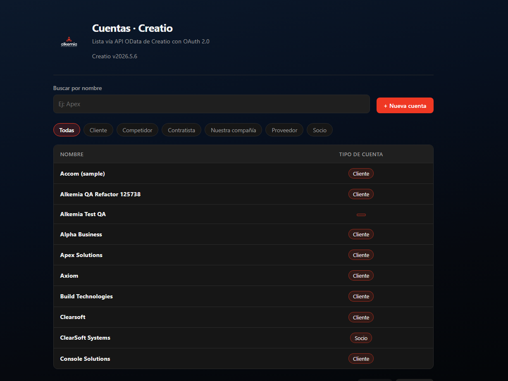
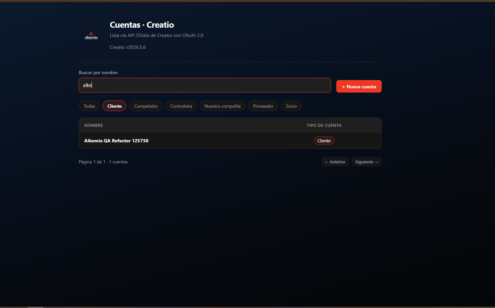
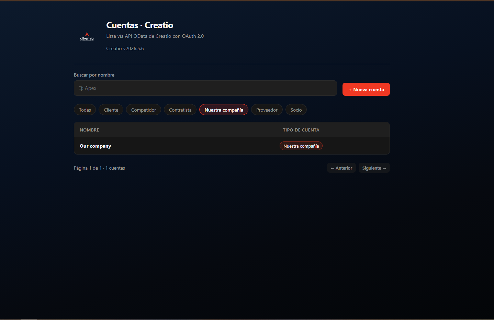

<p align="center"></p>

# Cuentas · Creatio (Prueba técnica Alkemia)

Resolví la prueba técnica con una Resolví la prueba técnica con una app web que consume la **API OData de Creatio** autenticando contra el **Identity Service** con **OAuth 2.0 client credentials**. Muestra un listado de cuentas (Accounts) con búsqueda y paginación resueltas del lado del servidor.

- **Backend:** ASP.NET Core Web API (`.NET 9`) — `backend/`
- **Frontend:** React + Vite + TypeScript + CSS nativo — `frontend/`
- **Versión de Creatio:** v2026.5.6
- **Instancia:** https://189637-crm-bundle.creatio.com
- **Bitácora de la integración:** [`BITACORA.md`](BITACORA.md) — ahí cuento lo que me costó y cómo lo resolví.

---

## Estructura

```
backend/CreatioAccounts.Api/
  Program.cs                  composición (config, DI y pipeline)
  Configuration/             opciones de Creatio + AddCreatio() (bind + validación + DI)
  Contracts/
    Accounts/                DTOs de cuentas (AccountItem, AccountListResponse, CreateAccountRequest)
    AccountTypes/            DTO de tipos de cuenta (AccountType)
  Integration/               transporte hacia Creatio (análogo a src/lib/api.ts)
    CreatioODataClient.cs    request + bearer + retry 401 + parseo
    CreatioTokenService.cs   caché/renovación del token (OAuth client credentials)
    CreatioApiException.cs
  Services/                  lógica de dominio (filtros OData $filter/$select/$expand)
    CreatioODataService.cs
  Infrastructure/
    EnvFileLoader.cs         carga de .env
    Middleware/              manejo global de errores (UseErrorHandling())
  Controllers/               AccountsController, AccountTypesController

frontend/
  src/views/                 composición de pantallas (AccountsView)
  src/components/ui/         primitivas reutilizables (Button, Input, Table, …)
  src/components/accounts/   componentes del dominio Cuentas (tabla, alta, filtro por tipo)
  src/hooks/                 useAccounts (fetch), useAccountTypes, useDebounce
  src/lib/                   api client (getAccounts, getAccountTypes, createAccount)
  src/types/                 un tipo/interfaz por archivo (AccountItem, TableProps, …)
  src/assets/
    constants/               ACCOUNT_COLUMNS, ACCOUNT_PAGE_SIZE
    img/                     imágenes procesadas por Vite
  src/global/style.css       tema nativo (paleta del logo) y clases de UI
```

---

## Cómo levantar todo desde cero

### 1. Configurar credenciales

Crear un archivo `.env` en la raíz del repo (no se sube, ver `.env.example`):

```
CREATIO_INSTANCE_URL=https://189637-crm-bundle.creatio.com
CREATIO_TOKEN_URL=https://189637-crm-bundle-is.creatio.com/connect/token
CREATIO_CLIENT_ID=<client-id>
CREATIO_CLIENT_SECRET=<client-secret>
CREATIO_ODATA_BASEPATH=/0/odata
```

También se pueden definir como variables de entorno reales con esos mismos nombres. El backend valida que estén completas al arrancar.

> Las credenciales corresponden a la instancia provista con el challenge y no viajan en el repo por seguridad.

### 2. Backend

Desde la raíz del repo:

```
cd backend
dotnet run
```

Queda en `http://localhost:5113`. Endpoints:

- `GET /api/accounts?search=nombre&type=Cliente&page=1&pageSize=10` → `{ items, total, page, pageSize }`
- `GET /api/account-types` → tipos de cuenta de Creatio (para los filtros del front)
- `POST /api/accounts` con `{ "name": "...", "typeId": "opcional" }` → crea la cuenta (bonus)
- `GET /health`

### 3. Frontend

Desde la raíz del repo, abrí otro terminal y:

```
cd frontend
npm install
npm run dev
```

Abrí `http://localhost:5173`. Vite hace proxy de `/api` y `/health` hacia `http://localhost:5113` (no hace falta CORS en dev). Con el backend corriendo, el listado debería cargar con las cuentas de la instancia.

---

## Cómo se configuró el acceso OAuth 2.0 (client credentials)

La primera pared que tuve que atravesar fue conseguir que el usuario técnico pudiera consumir OData; sin los permisos correctos, todos los request devolvían *"El usuario actual no tiene permisos suficientes para usar OData"*. Esto es lo que hice:

1. **System Designer** → **OAuth 2.0 integrated applications** (bloque _Import and integration_).
2. **New** → tipo **Server-to-server (client credentials)**.
3. Completar Nombre/URL/Descripción y dejar activado **Create separate technical user**.
4. Creatio genera **Client Id** y **Client secret**; se guardan fuera del repositorio (`.env` + variables de entorno).
5. Asignar permisos al **usuario técnico**: operaciones **Access to OData** y **View any data** (sin eso, cualquier request devuelve `El usuario actual no tiene permisos suficientes para usar OData`).
6. El token se pide en `POST {IdentityServiceUrl}/connect/token` con `grant_type=client_credentials` (form-urlencoded: `client_id`, `client_secret`).

> La URL del Identity Service la da el system setting **`OAuth20IdentityServerUrl`** (_Authorization server Url for OAuth 2.0 integrations_).

Fuentes consultadas:

- Creatio Academy — [Set up client credentials grant](https://academy.creatio.com/docs/8.x/no-code-customization/base-integrations/oauth-2-0/set-up-the-oauth-2-0-authorization-instruction)
- Creatio Academy — [Authorize external requests (client credentials grant)](https://academy.creatio.com/guides/dev/development-on-creatio-platform/8.2/integrations-and-api/authentication/oauth-2-0-authorization/identity-service-overview)
- OAuth 2.0 — [Client types](https://oauth.net/2/client-types/) (por qué el "Public client" tenía que quedar apagado)
- [Plecto → Creatio integration guide](https://docs.plecto.com/kb/guide/en/creatio-IpChCf4mSq/Steps/4070710) (permisos del usuario técnico para OData)

---

## Decisiones técnicas y por qué

- **OAuth solo del lado del backend.** El frontend nunca ve el `client_secret`; el backend es el único orquestador de la integración. Eso mantiene las credenciales fuera del browser y simplifica la app web.
- **Caché y renovación del token.** `CreatioTokenService` cachea el `access_token` en memoria con `SemaphoreSlim` (evita pedir uno nuevo en cada request y evita "stampede" cuando expiran). Renueva antes de la expiración (grace de 60s sobre el `expires_in`) y, ante un `401`, invalida el caché y vuelve a pedirlo una única vez.
- **Paginación y búsqueda 100 % en servidor.** Se traduce `page`/`pageSize` a `$top`/`$skip`, la búsqueda a `$filter=contains(Name,'...')`, y se pide `$count=true` para el total real. El frontend solo corta visualmente la página que recibe.
- **Solo los campos mostrados.** `$select=Id,Name,TypeId,Type` en lugar del registro completo.
- **Lookup resuelto legible.** `$expand=Type` devuelve el tipo de cuenta (p. ej. "Cliente", "Contratista") sin exponer el GUID a cara o cruz.
- **Filtro por tipo de cuenta.** `type` se traduce a `$filter=Type/Name eq '...'`. El `$filter=TypeId eq guid'…'` resulta que no lo acepta la versión: `TypeId` viaja como `Edm.Guid` y el parser no reconoce el literal `guid'…'`; filtrar por la propiedad navegacional `Type/Name` sí resuelve.
- **Transporte separado de la lógica.** `Integration/CreatioODataClient` hace HTTP/bearer/retry 401/parseo; `Services/CreatioODataService` solo arma queries y DTOs. Quedaron listas para mockear y testear por separado.
- **Errores visibles.** El backend mapea fallos de Creatio a `{ error: { code, message } }` con middleware global; el frontend los muestra en un banner (listado y alta).
- **Config por `.env`/variables de entorno** con un loader propio liviano (sin dependencias extra) y validación al arranque.
- **CORS no necesario en dev** gracias al proxy de Vite; igualmente se habilita en Development por comodidad.

## Qué dejé afuera y qué haría con más tiempo

- No hay tests automatizados (los servicios están detrás de interfaces `ICreatioTokenService` / `ICreatioODataService`, listas para mockear).
- No hay validación de duplicados ni normalización de nombre al crear cuentas.
- Con más tiempo: `authorization code + PKCE` para usuarios humanos, logs estructurados, contenedor Docker para backend y frontend, CI, reintento con `jitter` para 429/5xx y un health-check dedicado del Identity Service.

## Capturas







## Deploys en vivo

- Frontend (Vercel): https://creatio-accounts.vercel.app/
- Backend (Render): https://creatio-accounts.onrender.com/health

Nota: el back puede tardar ~30-60s en el primer arranque (free tier).


| Variable | Descripción |
| --- | --- |
| `CREATIO_INSTANCE_URL` | URL base del CRM (`https://<instancia>.creatio.com`). |
| `CREATIO_TOKEN_URL` | Endpoint del token (`POST <url>/connect/token`). |
| `CREATIO_CLIENT_ID` | Client id de la integración OAuth. |
| `CREATIO_CLIENT_SECRET` | Client secret de la integración OAuth. |
| `CREATIO_ODATA_BASEPATH` | Base del servicio OData (default `/0/odata`). |
| `VITE_API_BASE_URL` (opcional) | Base de la API si el frontend no usa el proxy (default `/api`). |

